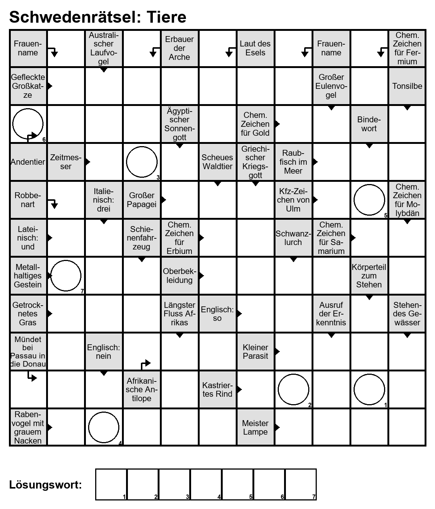
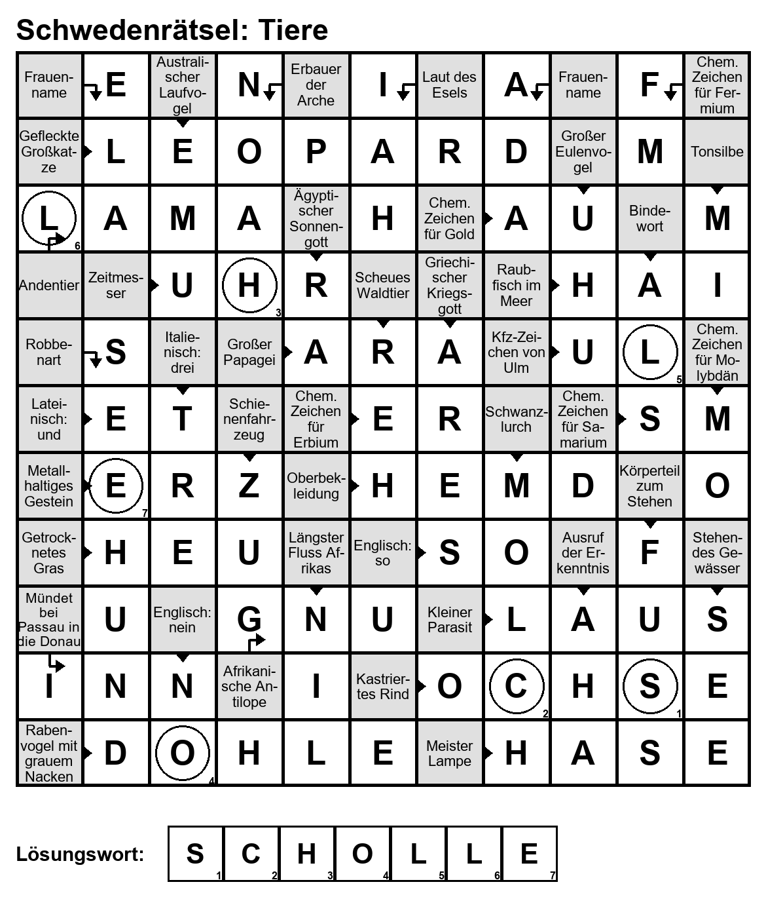

# Schwedenrätsel-Generator mit Claude als Lektor

Ein Desktop-Programm, das aus einer Wortdatenbank Schwedenrätsel erzeugt, wie man sie
aus Zeitschriften kennt. Die Rätsel können dann ausgedruckt und von Hand gelöst werden. Dies entstand aus der Idee, persönliche Rätsel
zu verschenken. Ein KI-Agent (Claude von Anthropic) kann wenn gewünscht als Lektor die Datenbank und fertige Rätsel überprüfen.

Die Idee, die Anforderungen und alle Produktentscheidungen stammen von mir. Den Code habe ich mit
[Claude Code](https://claude.com/claude-code) geschrieben. Das Projekt zeigt, wie ich mit einem KI-Coding-Agenten
von einer Idee zu einem fertigen Werkzeug komme und wie ich ein Sprachmodell gezielt in eine Anwendung einbaue.

<p align="center">
  
  
</p>
<p align="center"><sub>Erzeugt mit <code>tools/beispielbild.py</code> aus der öffentlichen Beispiel-Datenbank:
11 × 11 Felder, 42 Wörter, davon 15 zum Thema Tiere, Lösungswort SCHOLLE.</sub></p>

<!-- Screenshot der Oberfläche hier einfügen, z. B. docs/oberflaeche.png -->

## Was das Programm kann

- **Schwedenrätsel:** Die Fragen stehen im Gitter, Pfeile zeigen gerade oder abgeknickt auf das Wort. Jede
  Frage hat ein eigenes Kästchen, es gibt keine grauen Leerfelder, und fast jeder Buchstabe gehört zu zwei Wörtern.
- **Themen:** Wörter sind getaggt (`tiere`, `geographie`, eigene Tags für persönliche Rätsel). Der Generator
  bevorzugt Themenwörter und füllt mit kurzen Füllwörtern auf. Ein Themen-Modus erzeugt N Rätsel und behält das
  mit den meisten Themenwörtern.
- **Druckfertiges PDF** in A4 oder A5 zum Falten, mit Lösungswort und Lösungsblatt, inklusive deutscher
  Silbentrennung in den Fragekästchen.
- **Datenbank-Pflege** in einer Oberfläche: Suche, Filter, Herkunft jedes Begriffs (automatisch erzeugt, selbst
  eingegeben, eingesendet) und ein Dashboard, das die Datenbank analysiert und zeigt, welche Wortlängen dem Generator fehlen.
- **Einsendungen:** Familie und Freunde können Begriffe über ein Google-Formular einreichen, das Programm übernimmt
  sie (mit Duplciate-Prüfung).
- **Claude als Lektor:** bewertet jeden Begriff und begutachtet fertige Rätsel (siehe unten).

## Algorithmus und Sprachmodell: wer macht was?

Am Anfang stand die Frage, ob ein Agent das ganze Rätsel entwerfen könnte. Die Antwort war nein, da ein dichtes
Schwedenrätsel ein hartes Problem aus vielen Buchstaben-Bedingungen ist. Ein Suchalgorithmus löst es in Sekunden und
garantiert jede Kreuzung. Sprachmodelle verzählen sich bei Buchstaben. Dafür beurteilen sie Sprache gut: Ist eine
Frage richtig, eindeutig und kurz genug? Kennt man den Begriff? Passen die Füllwörter zum Thema?

Daraus ergibt sich die Aufteilung:

| Aufgabe | Wer | Wie |
|---|---|---|
| Muster aus Frage- und Buchstabenfeldern | Algorithmus | Zufallsmuster, Prüfung der Fragezuordnung per bipartitem Matching |
| Wörter einsetzen | Algorithmus | Backtracking, engste Lücke zuerst, parallel auf allen Prozessorkernen |
| Qualität der Begriffe und Fragen | Claude | Bewertung 1–5 Sterne, Probleme, Verbesserungsvorschläge |
| Themenbezug, Abwechslung, Schwierigkeit | Claude, gestützt auf Zahlen | Gutachten zum fertigen Rätsel |
| Entscheidung | Mensch | Vorschläge werden angezeigt, nie automatisch übernommen |

### Wie die Claude-Anbindung gebaut ist

Die Anbindung steckt in [`sr/claude_check.py`](sr/claude_check.py) und nutzt das offizielle Anthropic-SDK.

- **Feste Antwortformate:** Jede Anfrage gibt ein JSON-Schema vor (Structured Outputs). Problemarten sind feste
  Codes, Bewertungen feste Werte. Die Antworten lassen sich so ohne Textzerlegung weiterverarbeiten.
- **Nur Änderungen prüfen:** Für jeden Begriff speichert das Programm einen Fingerabdruck aus Frage, Antwort und
  Tags. Ein neuer Durchlauf schickt nur neue und geänderte Begriffe an Claude.
- **Kosten im Griff:** Vor dem Start schätzt das Programm die Kosten und fragt nach. Danach zeigt es die echten
  Kosten aus den Token-Zählern. Die Begriffe gehen in Paketen von 60 an Claude, vier Anfragen laufen parallel.
  Eine Prüfung der ganzen Beispiel-Datenbank kostet wenige Euros, ein einzelnes Rätsel wenige Cent.
- **Robust:** Fertige Pakete werden sofort gespeichert. Abbruch oder Fehler kosten keine bereits bezahlte Arbeit.
  Lehnt das Modell eine Anfrage ab, springt serverseitig ein Ersatzmodell ein. Fehler erscheinen als
  verständliche Meldungen statt als Programmabsturz.
- **Fakten vor Meinung:** Beim Rätsel-Gutachten rechnet das Programm die harten Zahlen selbst aus (Anteil der
  Themenwörter, aus welchen Themen die Füllwörter kommen) und gibt sie Claude mit. Das Modell urteilt, zählt aber
  nicht.
- **Mensch entscheidet:** Claudes Vorschläge erscheinen in einer Liste mit „Übernehmen“, „Abhaken“ und
  „Begriff meiden“. Mit ★1 bewertete Begriffe lässt der Generator auf Wunsch weg.
- **Kein Schlüssel im Code:** Der API-Schlüssel kommt aus einer Umgebungsvariablen oder liegt im Benutzerprofil,
  nie im Projektordner.

## Wie ich mit Claude Code gearbeitet habe

Das Projekt ist schrittweise im Dialog mit Claude Code entstanden.

- **Ich habe die Anforderungen gesetzt und präzisiert.** Ein Beispiel ist „jede Frage in einem eigenen Kästchen,
  keine grauen Felder“. Diese Regel ist strenger als bei vielen Generatoren und hat den Algorithmus geprägt.
- **Zuerst ein Prototyp im Browser (HTML/JavaScript), dann der Umzug nach Python.** Python brachte mehrere
  Prozesse für die Suche, eine Desktop-Oberfläche und sauberen PDF-Export.
- **Ich habe an echten Ergebnissen getestet.** Ich habe Rätsel ausgedruckt, gelöst und verschenkt und aus den
  Erfahrungen neue Anforderungen gemacht: A5-Format zum Falten, feste Begriffe, Themen-Modus, Einsendungen über
  ein Formular.
- **Ich habe Entscheidungen getroffen, wo es Abwägungen gab.** Beispiele: welches Modell, welche Kosten
  akzeptabel sind, dass Claude-Vorschläge nie automatisch übernommen werden.
- **Ich habe private und öffentliche Daten getrennt.** Persönliche Rätsel bleiben lokal. Das öffentliche
  Repository enthält nur allgemeine Begriffe, und `.gitignore` hält private Dateien heraus.

## Technik

| Bereich | Umsetzung |
|---|---|
| Sprache | Python 3.10+ (etwa 3.600 Zeilen in `sr/`) |
| Oberfläche | tkinter mit eigenem Dashboard (Diagramme direkt auf dem Canvas) |
| Rätselsuche | eigener Generator: Backtracking, bipartites Matching, `multiprocessing` |
| PDF | reportlab, ein gemeinsames Layout für PDF und Vorschau |
| KI | Anthropic Python SDK, Claude Opus 5.5, Structured Outputs, serverseitiger Fallback |
| Daten | CSV (Excel-tauglich), JSON für Einstellungen und Prüfergebnisse |

```
sr/
├── generator.py      Muster und Füllen, parallel
├── puzzle.py         Datenmodell, Fragezuordnung, Regelprüfung
├── layout.py         Blattlayout, Silbentrennung, Pfeile
├── pdf.py            PDF-Export
├── claude_check.py   Prüfung durch Claude
├── service.py        Wortauswahl nach Themen, Lösungswort
├── words.py          CSV lesen/schreiben, Normalisierung (Ä → AE)
├── einsendungen.py   Import aus Google-Formular
├── stats.py, charts.py  Dashboard
└── gui.py            Oberfläche
tests/                Tests ohne echte API-Aufrufe
tools/beispielbild.py Bilder für diese README
```

## Ausprobieren

Voraussetzungen: Windows und Python 3.10 oder neuer.

1. Repository herunterladen und `start.bat` doppelklicken. Beim ersten Start wird eine Python-Umgebung
   eingerichtet, und die Beispiel-Datenbank mit rund 1.150 Begriffen wird als `woerter.csv` angelegt.
2. Im Reiter „Rätsel erstellen“ ein Thema wählen und „Rätsel erzeugen“ klicken.
3. Für die Claude-Prüfung im Reiter „Datenbank“ unter „Claude-Zugang…“ einen API-Schlüssel eintragen. Das ist
   optional, das Programm funktioniert auch ohne.

Ohne Oberfläche:

```
.venv\Scripts\python -m sr --breite 13 --hoehe 15 --zeit 20 --themen tiere --pdf tiere.pdf
```

Tests:

```
.venv\Scripts\python -m unittest discover tests
```

Die ausführliche Bedienungsanleitung steht in [ANLEITUNG.md](ANLEITUNG.md).
